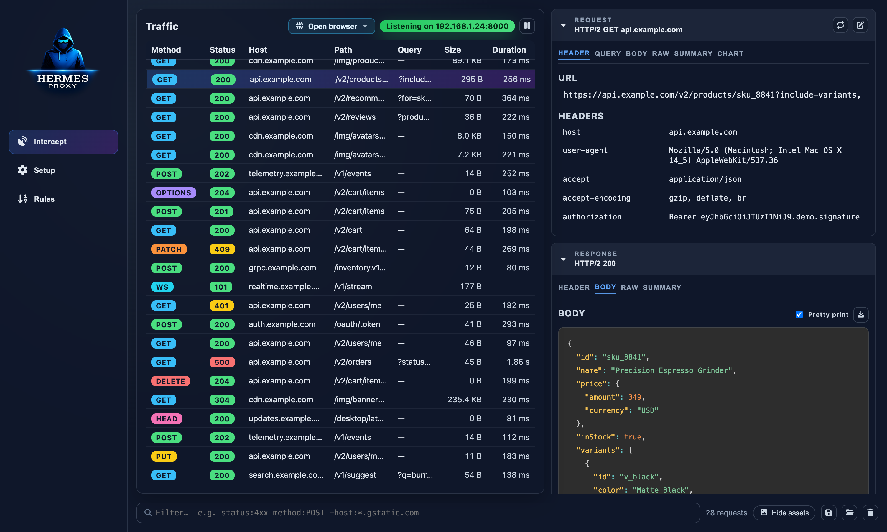
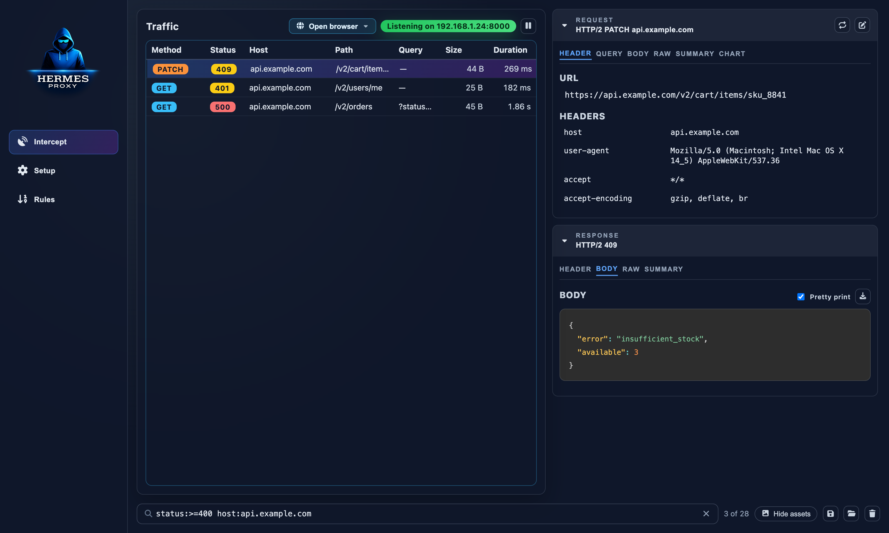
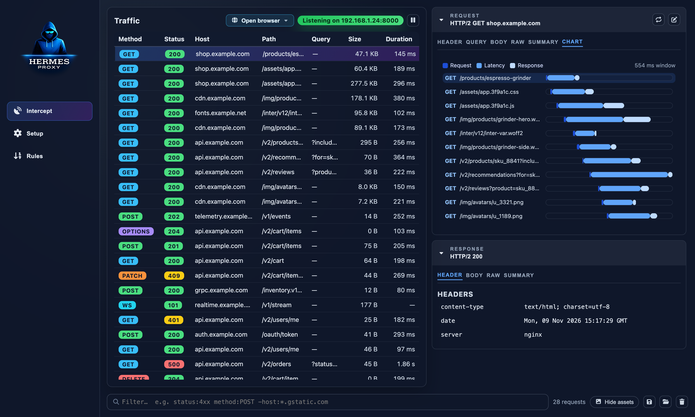
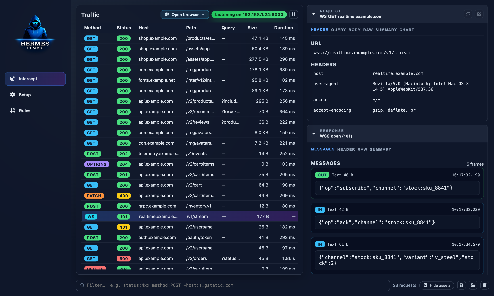
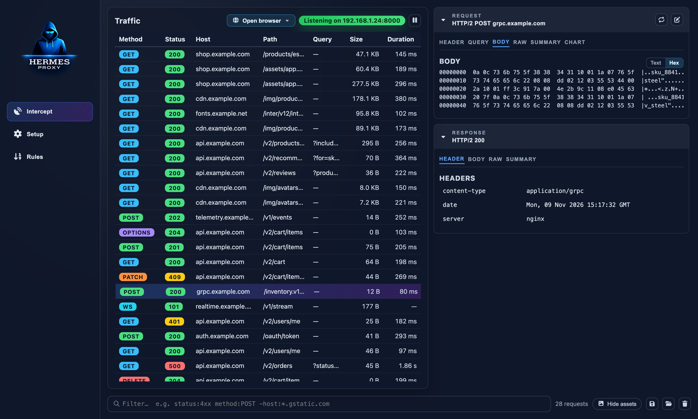
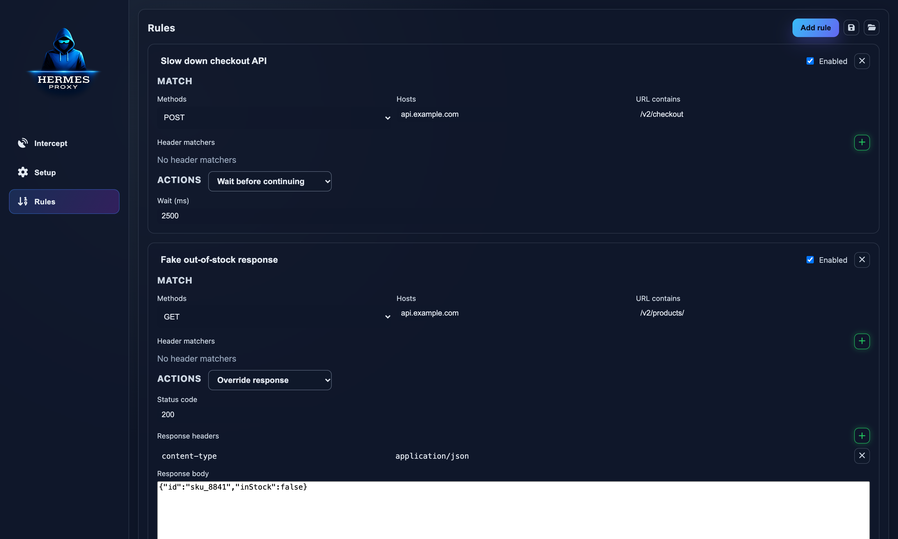
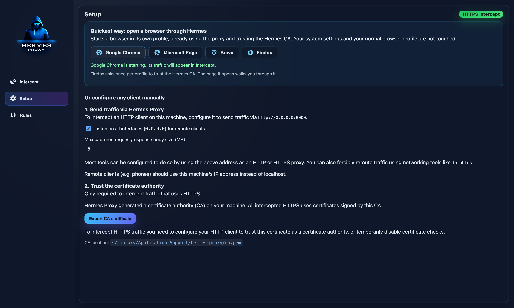

<div align="center">


# Hermes Proxy

**See, filter, replay and rewrite every HTTP, HTTPS and WebSocket request your apps make.**

A free, open-source desktop intercepting proxy for debugging APIs, mobile apps, games and anything else that talks over HTTP.

[](https://github.com/jp/Hermes-Proxy/actions/workflows/ci.yml)
[](LICENSE)




</div>

## Why Hermes Proxy?

- **One click to start.** Open Chrome, Edge, Brave, Firefox and friends already routed through Hermes and trusting its certificate, without touching system proxy settings or certificate stores.
- **Everything in one place.** HTTP/1.1, HTTP/2, HTTPS (via a local CA) and WebSockets in a single live list.
- **Find the needle fast.** Structured filters like `status:>=400 host:api.example.com -path:/health`, sortable columns, and one click to hide images, fonts and scripts.
- **Change what the app sees.** Rules can delay requests, rewrite headers, return a fake response or drop the connection, with no code changes in the app under test.
- **Replay and edit.** Re-send any request, or open it in an editor and change the URL, headers or body first.
- **Share what you found.** Export everything (or just a selection) as HAR, copy as cURL / fetch / PowerShell, or import someone else's HAR.
- **Local and private.** No account, no cloud. Traffic never leaves your machine.

## Tour

| | |
|---|---|
|  |  |
| **Filter like a query language.** Combine method, status ranges, host wildcards, content type and negation. | **Waterfall chart.** See every request a page triggered, with send / wait / receive timings. |
|  |  |
| **WebSocket frames.** Every message in and out, with direction, size and timestamp. | **Binary bodies.** gRPC, protobuf, images and other non-text payloads open in a hex view. |



## Features

**Capture**
- Open a pre-configured browser (Chrome, Chrome Canary, Chromium, Edge, Brave, Vivaldi, Opera, Firefox) in its own profile, with no system changes
- HTTP, HTTPS and WebSocket interception through an [mockttp](https://github.com/httptoolkit/mockttp)-powered proxy
- Auto-generated local certificate authority, exportable from the Setup tab
- Listen on all interfaces to capture phones, tablets, VMs and other devices on your network
- Pause / resume recording without stopping the proxy
- Configurable max captured body size

**Inspect**
- Live, virtualized traffic table that stays fast with thousands of requests
- Columns for time, method, status, host, path, query, content type, size and duration. Click to sort, right-click to show or hide; your layout is remembered.
- Request & response headers, query params, raw view, summary (caching, compression, sizes)
- Pretty-printed and syntax-highlighted JSON and HTML, hex dump for binary bodies
- Waterfall chart of a request and everything it triggered

**Act**
- Replay a request as-is, or edit URL/headers/body in a dedicated editor window
- Rules: match by method, host, URL and headers; then delay, override headers, override the whole response, or close the connection
- Create a rule straight from a captured request (right-click → *Add matching rule*)
- Copy as URL, cURL, fetch or PowerShell; copy response body; save body to file
- Export all or selected requests as HAR, import HAR files
- Delete individual requests or clear the whole session

## Getting started

### Install

Prebuilt binaries for macOS, Windows and Linux are attached to each [GitHub release](https://github.com/jp/Hermes-Proxy/releases).

> [!NOTE]
> Release builds are not code-signed yet, so macOS Gatekeeper and Windows SmartScreen may refuse to open them. Until then, running from source (below) is the most reliable option.

### Run from source

Requires Node.js 20.19+ (22 LTS recommended).

```bash
git clone https://github.com/jp/Hermes-Proxy.git
cd Hermes-Proxy
npm install
npm run dev
```

### Open a browser through Hermes

The fastest way to start: click **Open browser** above the traffic list (or use the **Setup** tab) and pick one of the browsers Hermes found on your machine.



The browser opens in a **dedicated profile** that already uses the proxy, so your everyday profile and system settings stay untouched. On first launch it opens `http://hermes.proxy`, a page served by Hermes that confirms HTTP and HTTPS interception are working.

- **Chrome, Edge, Brave, Chromium, Vivaldi, Opera**: HTTPS works immediately. Hermes tells the browser to trust its CA for that profile only (`--ignore-certificate-errors-spki-list`), so nothing is installed.
- **Firefox**: the landing page has a *Trust Hermes CA in this profile* button. Firefox asks once per profile.

Profiles are kept between launches (logins and cookies included) in Hermes' data folder under `browser-profiles/`. Browsers started by Hermes are closed when Hermes quits.

### Send traffic through it manually

Hermes listens on port `8000` by default. The exact address is shown at the top of the traffic list and in the **Setup** tab.

```bash
# A single command
curl -x http://localhost:8000 https://httpbin.org/get

# Most CLI tools and SDKs honor the standard proxy variables
export HTTP_PROXY=http://localhost:8000
export HTTPS_PROXY=http://localhost:8000

# Launch a desktop app with the proxy set (macOS)
HTTPS_PROXY=http://localhost:8000 open -a "Some App"
```

For browsers, set `localhost:8000` as the HTTP and HTTPS proxy in your system or browser network settings. For a phone or another machine, enable **Listen on all interfaces** in Setup and use this computer's LAN IP.

### Trust the certificate (HTTPS only)

To see HTTPS contents, clients must trust the Hermes CA. Export it from **Setup → Export CA certificate**, then:

| Platform | How to trust it |
|---|---|
| macOS | Double-click the `.cer`, then in Keychain Access set it to *Always Trust* |
| Windows | Double-click → *Install Certificate* → *Local Machine* → *Trusted Root Certification Authorities* |
| Linux | Copy to `/usr/local/share/ca-certificates/` and run `sudo update-ca-certificates` |
| iOS | AirDrop/email the file, install the profile, then enable it in *Settings → General → About → Certificate Trust Settings* |
| Android | *Settings → Security → Install a certificate → CA certificate* (apps must opt in to user CAs) |
| Node.js | `NODE_EXTRA_CA_CERTS=<CA location shown in Setup>` (that file is PEM; the exported `.cer` is DER) |

> [!WARNING]
> Anyone with this CA's private key can impersonate any HTTPS site to devices that trust it. The key stays in your user data folder. Remove the CA from devices you no longer test on.

## Filter syntax

Type in the filter bar at the bottom of the traffic list (<kbd>⌘/Ctrl</kbd>+<kbd>F</kbd>). All terms must match.

| Term | Matches |
|---|---|
| `checkout` | Free text across URL, status, headers and WebSocket payloads |
| `"two words"` | Quoted free text |
| `method:POST` | HTTP method (`WS` for WebSockets) |
| `status:404` · `status:5xx` · `status:>=400` | Exact status, class, or comparison (`>`, `>=`, `<`, `<=`) |
| `host:*.example.com` | Host, with `*` wildcards (substring match without them) |
| `path:/v2/cart` | Path and query string |
| `type:json` | Response content type |
| `-host:cdn.example.com` | Prefix any term with `-` to exclude it |

Example: `method:POST status:>=400 -host:telemetry` shows failed writes, ignoring telemetry.

## Keyboard shortcuts

| Shortcut | Action |
|---|---|
| <kbd>↑</kbd> / <kbd>↓</kbd> | Previous / next request |
| <kbd>Home</kbd> / <kbd>End</kbd>, <kbd>PgUp</kbd> / <kbd>PgDn</kbd> | Jump to first / last, page up / down |
| <kbd>Shift</kbd>/<kbd>⌘</kbd>/<kbd>Ctrl</kbd> + click | Select a range / toggle a request |
| <kbd>⌘/Ctrl</kbd>+<kbd>A</kbd> | Select all visible requests |
| <kbd>Delete</kbd> / <kbd>Backspace</kbd> | Delete selected requests |
| <kbd>Esc</kbd> | Clear the selection (or the filter, when it is focused) |
| <kbd>⌘/Ctrl</kbd>+<kbd>F</kbd> | Focus the filter |

## Rules

Rules are checked top to bottom and the **first enabled rule that matches** is applied. A rule matches when **all** its conditions match (each list matches if **any** entry is a case-insensitive substring):

- **Methods**: e.g. `POST` (leave empty for any)
- **Hosts**: e.g. `api.example.com`
- **URL contains**: e.g. `/v2/checkout`
- **Header matchers**: name and/or value substrings

Actions: **Wait before continuing** (add latency), **Override headers**, **Override response** (status, headers, body), or **Close connection**. Rules are saved automatically and can be exported/imported as JSON to share with your team.

## Development

```bash
npm run dev            # Vite + Electron with hot reload
npm test               # Vitest in watch mode
npm run test:coverage  # One-off run with coverage
npm run build          # Build renderer and Electron main process
npm run dist -- --publish never   # Package binaries with electron-builder
```

Pushing a git tag builds macOS, Windows and Linux binaries in GitHub Actions.

### Project layout

```
electron/
  preload.js          IPC bridge exposed to the renderer as window.electronAPI
  src/main/           Main process: proxy (mockttp), CA, rules, HAR, replay, menus
src/
  features/traffic/   Traffic list, request/response inspector, request editor
  features/rules/     Rules editor
  features/setup/     Proxy settings and CA export
  utils/              Filtering, sorting, formatting and HTTP helpers
  __tests__/          Vitest + Testing Library tests
```

## Contributing

Bug reports, feature ideas and pull requests are welcome. Please open an [issue](https://github.com/jp/Hermes-Proxy/issues) first for larger changes so we can agree on the approach. Before sending a PR, make sure `npm run test:coverage` passes.

## License

[GPL-3.0](LICENSE)
